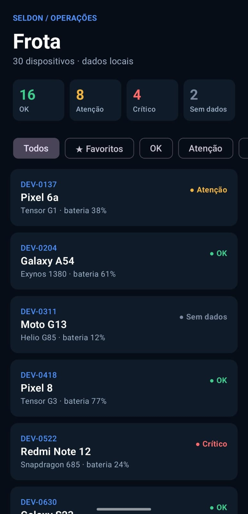
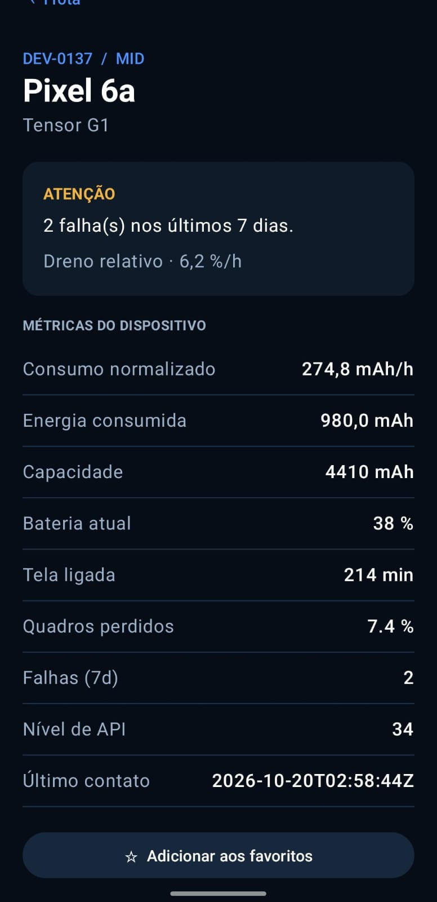

# Seldon Fleet

Aplicativo Android em Kotlin e Jetpack Compose para monitorar uma frota de dispositivos a partir de um arquivo local. O app lista os aparelhos, classifica a saúde da bateria e do desempenho, abre os detalhes com a justificativa do status e mantém favoritos persistidos.

Este README segue a organização da [solução de referência](https://github.com/maktheus/seldon-fleet-solution/blob/main/README.md), adaptada à implementação deste repositório.

## Funcionalidades

- Lê os 30 dispositivos de `app/src/main/assets/frota.json`, sem chamadas de rede.
- Filtra por status e por favoritos; os contadores mostram a quantidade em cada estado.
- Abre uma tela de detalhe com os dados normalizados e a justificativa da classificação.
- Persiste os IDs favoritos com Preferences DataStore.
- Mantém a regra de classificação no domínio, independente de Android e Compose.

## Capturas do app

### Lista da frota



### Detalhe do dispositivo



## Arquitetura

O fluxo principal é `frota.json -> AssetFileReader -> DeviceDto -> DeviceMapper -> Device -> casos de uso -> ViewModel -> Compose`.

| Camada | Responsabilidade |
|---|---|
| `data` | Lê o JSON dos assets, converte unidades, implementa o repositório e persiste favoritos. |
| `domain` | Define modelos, contrato do repositório e regras de classificação em Kotlin puro. |
| `ui` | Apresenta lista e detalhe, controla o estado de tela, filtros e navegação. |

Na tela de lista, o usuário pode filtrar todos os aparelhos, favoritos ou cada status. Ao abrir um detalhe, o filtro continua no `FleetViewModel`; voltar retorna à mesma lista filtrada.

## Regra de classificação

O dreno absoluto é calculado por `consumo_mAh / (minutos_de_tela / 60)`. O dreno relativo é `(dreno_absoluto / capacidade_mAh) x 100` e é comparado com os limites abaixo:

| Status | Condições |
|---|---|
| **Indeterminado** | Capacidade ausente ou menor/igual a zero, tempo de tela ausente ou menor/igual a zero, ou energia que não pode ser normalizada com segurança. |
| **Crítico** | Dreno relativo maior/igual a 12 %/h, 3 ou mais falhas em 7 dias, ou jank maior/igual a 15 %. |
| **Atenção** | Dreno relativo maior/igual a 7 %/h, uma ou mais falhas em 7 dias, ou jank maior/igual a 8 %. |
| **OK** | Nenhuma condição anterior foi atingida. |

Os sinais críticos têm precedência sobre os sinais de atenção. A justificativa informa o primeiro sinal que atingiu o limite. A decisão para os dados defeituosos e uma ameaça à validade estão documentadas em [PROTOCOLO.md](PROTOCOLO.md).

## Dados defeituosos

O arquivo tem energia em mAh e mWh. `DeviceMapper` converte mWh em mAh usando a tensão nominal (`mWh / V`) antes da classificação. Dados que não permitem uma conversão ou derivação segura continuam visíveis como **Indeterminado**, sem divisão por zero ou valores não finitos.

## Executar e validar

Abra o projeto no Android Studio, selecione a configuração `app` e execute em um dispositivo ou emulador Android. O projeto exige Android SDK para compilar; o app suporta dispositivos a partir da API 24.

Comandos do Gradle Wrapper:

```bash
# Linux ou macOS
./gradlew testDebugUnitTest assembleDebug

# Windows
gradlew.bat testDebugUnitTest assembleDebug
```

O APK debug é gerado em `app/build/outputs/apk/debug/app-debug.apk`. Os testes JVM cobrem a classificação nos limites, dados que não permitem cálculo e conversão de mWh para mAh. A GitHub Actions executa os testes e monta o APK em pushes e pull requests.

## Organização principal

```text
app/src/main/assets/frota.json
app/src/main/java/com/example/seldonfleet/
  data/       leitura, DTO, mapper, DataStore e repositório
  domain/     modelos, contrato e casos de uso
  ui/         navegação, telas, ViewModels e tema
app/src/test/ testes unitários JVM
docs/screenshots/ capturas da lista e do detalhe
PROTOCOLO.md decisões de regra e tratamento de dados
```

## Uso de IA e próximos passos

Assistentes de IA foram usados como apoio ao planejamento, implementação e revisão dos requisitos. As decisões de domínio, o código e os testes foram conferidos no projeto.

Como evolução, adicionaria testes de UI para a navegação e os filtros e uma captura adicional do estado com filtro aplicado em um emulador operacional.
